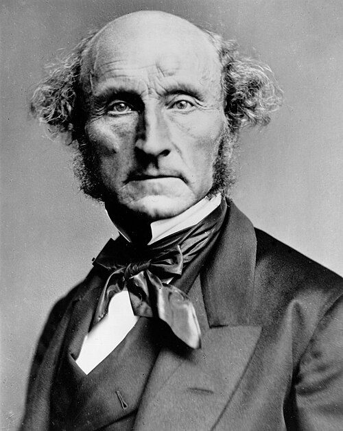

# A new unit

## Looking Back

We've done two units so far:

Epistemology
:    How do we learn about the world?

Mind
:    What kinds of things are minds?

. . .

I didn't clearly separate them, because perception is part of both discussions.

. . .

But that's all been about what kind of thing our world *is*; we now turn to what it *should be*.

## Where we're going

We've got fourteen classes left, in four blocks (again, there will be connections between the units).

Ethics
:    What makes an action right? Three classes, including this one.

Welfare
:    What makes a life go well? Four classes, starting in November.

The Self
:    What makes you the same person over time? Two classes, leading up to Thanksgiving.

Law and Politics
:    What is our relationship to the law and to the state, with a special focus on free spech. Five classes, to the end.

. . .

The first two blocks are what the essay is on.

## Relating the first two units

Here's a natural theory according to which the first two blocks are about the one idea.

:::: {.callout-note title="Hypothesis"}
An action is **right**, it is what you should do, just in case it makes everyone as well off as possible, i.e., it produces the most **welfare**.
::::

. . .

Hopefully that hypothesis should look neither obviously true nor obviously false.

The fact that it's not obviously true is enough to make the two units different; but the fact that it's not obviously false means that they are connected.

## One administrative note

The prompt goes out on 6 November with your Short Answer 2 feedback, and the essay is due 23 November. 

It will be on this material, so even if you weren't interested in the small question *How should I live?*, you have an instrumental reason to be interested in it.

# Consequentialism

## The basic thought

Intuitively, when you are thinking about what you should do, you should give at least *some* consideration to what effects it will have on the world.

If an action leads to making the world better, that counts for it. If it leads to making the world worse, that counts against it.

. . .

Consequentialism is the view that this is the *whole* story.

:::: {.callout-note title="Gronholz"}
We are obligated to do whatever action has the best *overall* consequences, for all who are affected by the action.
::::

## Two words, more and less precise

Consequentialism
:    What's right to do is just settled by what actions have the best consequences.

Utilitarianism
:    Consequentialism plus a theory of what it means for some consequences to be better: there is more happiness.

. . .

So utilitarianism is one way of filling in consequentialism. You could be a consequentialist and disagree with Mill about what's good.

For instance, one of my old professors is famous for arguing (roughly) that we should do whatever produces the most *autonomy*. That's consequentialist, but not utilitarian (as we're using the terms).

## John Stuart Mill

::: {layout="[38, 62]"}

::: {}
{.nostretch fig-alt="A photographic portrait of John Stuart Mill." width="80%"}
:::

::: {}
Arguably the most important English-language philosopher of the nineteenth century.

He has also been argued to be the most important English-language economists of the nineteenth century, though in those days (especially in Britain) the economics/philosophy distinction wasn't particularly sharp; almost all the leading economists were philosophers and mostly vice versa.

He spent most of his working life as an administrator for the East India Company, and three years as an MP.

. . .

We'll meet him again in December, when the topic is free speech.
:::

:::

## The Greatest Happiness Principle

:::: {.callout-note title="Mill, *Utilitarianism*, ch. 2"}
The creed which accepts as the foundation of morals, Utility, or the Greatest Happiness Principle, holds that actions are right in proportion as they tend to promote happiness, wrong as they tend to produce the reverse of happiness.
::::

. . .

:::: {.callout-note title="Mill"}
By happiness is intended pleasure, and the absence of pain; by unhappiness, pain, and the privation of pleasure.
::::

## Upsides

Impartiality
:    Everyone's happiness counts, to the same degree. No bonuses for being the favored race, religion, nationality, etc.

Non-arbitrariness
:    There's one principle, and everything follows from it. Compare a list of commandments; then you can ask what unifies them, why we stop there, whether any are more important than others, etc.

## The pigs objection

Mill is answering an objection before he's finished stating the theory, which normally you do if you're *really* used to hearing it.

:::: {.callout-note title="Mill"}
To suppose that life has (as they express it) no higher end than pleasure---no better and nobler object of desire and pursuit---they designate as utterly mean and grovelling; as a doctrine worthy only of swine.
::::

## Mill's reply

He doesn't deny that pleasure is what matters. He denies that all pleasures are the same kind of thing.

:::: {.callout-note title="Mill"}
It is quite compatible with the principle of utility to recognise the fact, that some *kinds* of pleasure are more desirable and more valuable than others.
::::

## Kinds of pleasure

There's an obvious question. If pleasure is what makes something valuable, what can make some pleasures *more* valuable? Mill suggests an algorithm for working this out.

:::: {.callout-note title="Mill"}
Of two pleasures, if there be one to which all or almost all who have experience of both give a decided preference, irrespective of any feeling of moral obligation to prefer it, that is the more desirable pleasure.
::::

. . .

You ask people who have had both which they prefer, and that's the more valuable one.

. . .

This is getting close to the view that would become more popular in the generation after Mill, and through to the present day: that **preferences** are what really matter, even more than **pleasures**.

## Mill's Argument (or at least bold assertion)

:::: {.callout-note title="Mill"}
It is better to be a human being dissatisfied than a pig satisfied; better to be Socrates dissatisfied than a fool satisfied. And if the fool, or the pig, is of a different opinion, it is because they only know their own side of the question. The other party to the comparison knows both sides.
::::

## Problems

1. How do we weigh up pleasures of different kinds? Is there some number of happy pigs that makes up for one Socrates? How do we work out what that number is?
2. The test is an empirical claim. Does the most fundamental fact about morality depend on *survey data*?

# Counterexamples

## Counterexamples

There are a number of everyday case 

## A promise nobody can check

Smith's closest friend is dying, and has no other family. She asks Smith to scatter her ashes in the Rockies, which are really important to her. Smith promise that they will.

The friend dies, and no one else knows about the promise.

. . .

And Smith is like, it's a long way to the Rockies, it will cost a lot of money and really be a bit of a drag. So they flush the ashes instead.

## A quick question (POLL)

**Has Smith done something wrong?**

A.  Yes, and the fact that nobody is worse off is beside the point.
B.  Yes, but only because of effects Smith hasn't thought of, like the guilt or the risk of discovery.
C.  No. Nothing bad happened to anybody.
D.  Yes, but it's a small wrong, and the trip would have been a bigger cost.

## What the case is doing

If you answered **A**, you think something other than consequences is carrying weight.

. . .

Gronholz gives the consequentialist two moves. 

The first is to find the missing consequences; this is what we did in **B**. Smith will feel the weight of the secret, or someone might get mad at them, etc.

. . .

The second is to accept the verdict. We just think this is bad because promise-breaking usually has bad consequences, or maybe we've been brainwashed to think promise-breaking is more important than it is.

## The transplant surgeon

Five people will die without transplants. They all really urgently need different transplants.

Good news; we have a donor who is a match for all five, and they are right here in the hospital.

. . .

Bad news; you're the donor! And you're not there to donate vital organs, but for a trivial operation.

. . .

The doctors could kill you quietly and save five lives. What great consequences!

## Why we shouldn't kill people

The consequentialist can insist that in any realistic version of this, the consequences would be bad. If this *ever* got out, so many people would avoid medical care that it would cost more than five lives.

. . .

But while that's true, it's both somewhat contingent (what if we really could cover it up), and feels like the wrong reason.

. . .

Killing you during a routine operation to save these five is wrong because of what it does to you, not because of the medical care that other later people decide to forego.

# Going forward

## The IOU

Consequentialism says: bring about the most good.

. . .

It doesn't say what the good *is*. Mill says happiness, and then stumbles over saying exactly what happiness is, how to measure it, and how to compare happinesses.

. . .

When we come back to welfare, we'll look at some more plausible candidates.

## Tuesday

Today's theory says that if the numbers come out right, nothing is off the table.

. . .

Tuesday we meet the family of views that says some things are off the table whatever the numbers say, and we start with possibly the most significant contribution that philosophy has made to recent pop-culture: the trolley problem.
