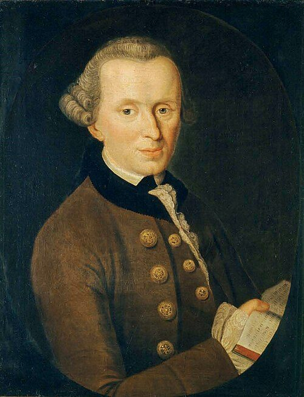

# Where we are

## Doing well and Doing the right thing

Thursday we set out a simple ethical theory: consequentialism.

. . .

We noted that in some easy to state cases, it leads to very unintuitive verdicts.

. . .

In both, the theory seemed to say something most people don't believe. So what does a theory that looks like actual beliefs look like?

## Today

The reading starts with a couple of cases that have become rather over-used in philosophy. 

Still, they are good cases, and it makes sense to start with them.

# Two trolleys

## Don't Switch

A runaway streetcar is heading for five people who will die if it crashes into them.

You are standing beside a lever. 

If you pull the level, the car will divert onto a side track. If you do that, it will crash into and kill one person instead.

. . .

So here are your options:

1. Do nothing; five people die.
2. Pull the lever; one person dies.

## iClicker POLL

What is the morally acceptable thing to do?

A.  Nothing; leave it crash into the five.
B.  Switch; steer it at the one.
C.  Either is morally acceptable.
D.  Neither is morally acceptable.

## Don't Push

The streetcar is still on the run, there are still five people in the way, but now you can reach the lever.

. . .

You can do *something* however. You are on a footbridge over the track, beside a very large man. If you push him off, his body will stop the car. This will be fatal for the man, but it will save the five.

. . .

So here are your options:

1. Do nothing; five people die.
2. Push the guy; one person dies.

## iClicker POLL

What is the morally acceptable thing to do?

A.  Nothing; leave it crash into the five.
B.  Push; the pushed guy dies.
C.  Either is morally acceptable.
D.  Neither is morally acceptable.

## What the pair is for

Across the two cases, the consequences are the same. In both cases, it's either one dies or five.

More precisely, in both cases it's either that one dies *because of your action* or five die *because of your inaction*.

. . .

But if you think the cases are different, and many people do, then there is something important other than consequences.

. . .

If that's right, consequentialism is false. 

## Acts and Omissions

There is a much simpler argument you might make around here against consequentialism.

1. Killing someone is morally worse than not rescuing a person who will otherwise die. (Neither are *good*, but the first is *worse*.)
2. Killing someone has the same consequences as not rescuing a person who will otherwise die. (A person dies.)
3. Therefore, there is more to morality than consequences.

. . .

This argument aims to show that you need to add an acts/omission distinction to consequentialism to get something plausible.

. . .

The trolley cases aim to show that even with that, you still have a problem.

## Careful here

The cases don't tell you *what* the solution to that problem could be; what needs to be added to the story.

. . .

They tell you that there is a rest of the story, and we'll use that to motivate one common kind of story that might help here.

# Deontology

## Deontology

The word comes from *deon*, Greek for duty. 

The theories we'll call deontological start from **rules**, lists of things you must or must do.

. . .

Here's a fairly famous version of such a list (I'm just quoting 3 of the list; famously there are 10.)

:::: {.callout-note title="Exodus 20"}
Thou shalt not kill. Thou shalt not steal. Thou shalt not bear false witness against thy neighbor.
::::

. . .

What's important here is not the source (i.e., divine command), or the content (don't steal/kill/lie, etc.) What's important is the shape; it says there are certain kinds of actions you can't do.

## Not every rule is absolute

Here's a big choice point in deontology. Do rules have exceptions?

- The 10 commandments are typically read as saying no.
- The most famous deontologist in modern philosophy, Immanuel Kant, is also read as saying no.
- But some deontologists say that it's fine to have exceptions to rules in extreme cases.

. . .

Imagine someone who won't push one person to save five, they still obey a rule against killing, but who would order a hijacked airliner shot down before it reaches a nuclear reactor.

They haven't suddenly become a utilitarian. They just think that the rule *don't kill* is a really strong rule, but less strong than a nuclear meltdown.

## A wider use of the word

Some philosophers, including in the readings, use "deontology" much more broadly:

:::: {.callout-note title="Chapman"}
Deontology is a type of moral theory that denies that morality is solely about consequences.
::::

. . .

That makes it sound like there are only two options: consequentialism or deontology. That's not a helpful way to think about ethics. 

## A wider use of the word

The wide use lumps together too many different things. It includes people who think:

- Ethics is mostly about character traits like being a brave person, or a friendly person, or an honest person (Aristotle)
- There are no systematic principles behind ethics, just good people know how to respond well to complicated situations (Dancy)
- Consequentialism is basically right, but it needs some **constraints** to rule out cases like the surgeon.

. . .

On this definition all three come out deontological, which turns the word into a name for everything that isn't one particular theory.

. . .

We'll use the narrow sense: a deontological theory starts with rules. 

When you see the word elsewhere, check whether they mean the broader or narrower reading. (It's annoying that the terminology isn't standardised)

## Where do the rules come from?

There is an old familiar answer: they come from divine authority. That's not too convicing to people who don't accept that particular divinity (or any divinity).

. . .

Without that, the question is open. And it's a hard question. Why do we have these rules and not others? Why not more rules? Why not fewer? What makes this a rule?

. . .

The most important answer in contemporary philosophy is due to Immanuel Kant: they are rules you must follow because you're a reasoner.

# Kant

## Immanuel Kant

::: {layout="[38, 62]"}

::: {}
{.nostretch fig-alt="A portrait of Immanuel Kant." width="80%"}
:::

::: {}
Kant spent his whole life in Königsberg, a port on the Baltic coast of what was then East Prussia. It's now, bizarrely, a non-contiguous part of Russia. 

He was the opposite of a prodigy. Almost everything he's remembered for (including the *Groundwork*) appeared after he was 55; he does have some earlier works which are read today, but I'm rather doubtful they would be remembered at all if he'd died at 54.

. . .

To give you a sense of how important Kant is to contemporary philosophy, he is basically the only philosopher in history where if a department like ours didn't have a specialist in his work on staff, we'd think "Oh that's a big gap, we should have a specialist." Plato and Aristotle come close, and obviously there are plenty of traditions and eras that need covering, but Kant's the only individual.

. . .

He is incredibly hard to read. The *Groundwork* is the most approachable of his major works, and we're reading it in a very loose translation.
:::

:::

## Two kinds of imperative

Most advice is conditional on what you want.

*If you want to pass the exam, do the reading.* If you don't care about passing, the advice goes away. Kant calls these **hypothetical** imperatives.

. . .

Moral demands aren't like that. *Don't lie to your friends* still applies even if you kind of want to lie.

:::: {.callout-note title="Chapman"}
This imperative is categorical in that we must follow it, even if we don't want to.
::::

## Maxims

We need one bit of Kantian terminology to get going.

:::: {.callout-note title="Chapman"}
A maxim is a principle for acting in a certain way to achieve a certain goal.
::::

. . .

It covers both *what you do* and *why you do it*. Example: *I will sneak into the cinema in order to see the film without paying.*

## The Categorical Imperative

:::: {.callout-note title="Kant, as Chapman gives it"}
Act only in accordance with that maxim through which you can at the same time will that it become a universal law.
::::

. . .

Here's Kant's big test for a maxim:

- Could everyone act on it?

## Working it through

Maxim: *I will sneak into the cinema without paying.*

Now imagine that everyone acts on it. Everyone sneaks in without paying.

. . .

Then cinemas take no money, and stop showing films, and there is nothing to sneak into.

. . .

The maxim destroys the institution that it depends on. You can't want everyone to do it. In Kantian terms, you can't coherently will it as a universal law. 

So you may not act on it.

## What the test is not

The objection to stealing is **not** that a world of thieves would be unpleasant.

. . .

It's that universal stealing would mean that there was no such thing as property. For something to be your property means (among other things) for people to generally respect your right to control it. That's compatible with the existence of some thieves, but if nobody at all thinks you have special rights over a phone, it really isn't your property.

And without property there is nothing to steal.

. . .

The universalised form of the maxim is not just *unpleasant*, it is *incoherent*.

## The second formulation

Kant gives what he says is a restatement of the same thing. Lots of people who are very sceptical that it is a restatement think that it's nevertheless interesting and important.

:::: {.callout-note title="Kant"}
Act so that you treat humanity, whether in your own person or in that of another, always as an end and never as a means only.
::::

. . .

"Merely" is doing a lot of work here. You use the barista as a means to coffee. Is that OK? Sure, as long as you don't treat him as *merely* that, and treat him as someone with his own ends. 

You can walk away from a broken coffee machine more easily than you can walk away from a broken barista.

## Back to the trolleys

This seems to get the trolley problems right.

. . .

**Pull the lever.** It's very sad that the guy on the side track dies, but he is not being used as an *instrument*. If he stepped off the track before the car arrived, your plan would work better.

. . .

**Push the man.** His body stopping the car *is* the plan. If he were not there, or not large enough, your plan would fail. As Chapman puts it: you use him as a mere sack of sinew and bones.

# The objection

## The murderer at the door

Here's a case Kant discusses, first suggested by Benjamin Constant.

Your friend is hiding in your house. A man who clearly intends to kill him knocks and asks where he is. (This is often treated as an absurdly unrealistic example, but if you remember Constant is writing in the 1790s, it doesn't seem to far-fetched.)

. . .

Lying is forbidden in Kant's theory. He thinks that if you universalise *I will lie when it suits me* you blow up the practice of assertion.

. . .

Kant held, in print, that you may not lie to the murderer. (Perhaps relatedly, Kant had some weird views about the French Revolution.) This is not his most popular view.

## Three Kantian replies

Bite the bullet. 
:    That is, accept a really implausible view. (Consequentialists who say you should kill the patient to save five are described the same way.) Here, it's agreeing with Kant.

Fix the maxim.
:     The maxim isn't *I will lie when it suits me*. It's *I will lie when doing so is very likely to save an innocent life*. That can be universalised.

Use the other formulation.
:    Helping the murderer find your friend treats her as a mere means to keeping your hands clean. So the second formulation forbids telling the truth.

## Which is least bad?

Each reply has downsides.

. . .

The first has an implausible verdict, and also a dead friend.

. . .

The second is a slippery slope towards allowing almost anything. It is coherent to universalise the maxim *Sneak into movies without paying on your birthday*, or *Sneak into movies without paying exactly 98 days after your birthday*.

. . .

The third makes the two formulations give opposite answers, which raises some deeper questions about the Kantian project.

## Thursday

We'll go back to the trolleys, with a focus on the philosopher most commonly associated with the problem.