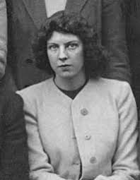
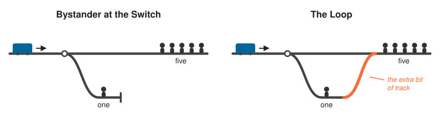

# Where we are

## Trolleys

We went over two trolley problems on Tuesday: pulling a lever, pushing a guy.

If you think a moral theory needs to treat those differently, consequentialism is in trouble.

. . .

There is a Kantian story about the difference. Pulling the lever doesn't use someone as a means, while pushing someone does.

## Today

Today we're going to look at cases that raise problems for this diagnosis, via a more thorough look at the philosopher who is most associated with the case.

# Foot's problem

## Philippa Foot

::: {layout="[35, 65]"}

::: {}
{.nostretch fig-alt="A photograph of Philippa Foot as a student at Somerville College, Oxford, in 1939." width="70%"}
:::

::: {}
Foot came up to Somerville College, Oxford, in 1939 to read PPE. Iris Murdoch and Mary Midgley, who we met earlier, were a year ahead of her there, and Elizabeth Anscombe was across town at St Hugh's. She was a fellow at Somerville for twenty years, and then at UCLA from 1976.

She is one of the people who brought virtue ethics back into Anglophone philosophy. Her mother was a daughter of Grover Cleveland, which makes her the granddaughter of a US president, and she was an active supporter of Oxfam for most of her adult life.

. . .

The trolley problem first appears in a paper from 1967 on abortion and double effect, which is where we're heading today. And when Thomson writes about what *Mrs. Foot* has arranged, this is who she means.
:::

:::

## Judith Jarvis Thomson

Thomson (1929-2020) studied at Barnard, then Cambridge, then took a doctorate at Columbia, and taught at MIT from 1964 until she retired.

Like Frank Jackson, who we met a few weeks ago, she worked on nearly everything: rights, metaphysics, action, the nature of goodness. Her best known paper is probably "A Defense of Abortion", from 1971.

. . .

She also did a lot of unglamorous institutional work. She chaired the committee that wrote the AAUP's report on institutional review boards, the bodies that decide which research on human subjects is allowed to go ahead at all.

## The driver

:::: {.callout-note title="Thomson"}
Suppose you are the driver of a trolley. The trolley rounds a bend, and there come into view ahead five track workmen... You step on the brakes, but alas they don't work. Now you suddenly see a spur of track leading off to the right. You can turn the trolley onto it, and thus save the five men on the straight track ahead. Unfortunately, Mrs. Foot has arranged that there is one track workman on that spur of track.
::::

. . .

Thomson: "Everybody to whom I have put this hypothetical case says, Yes, it is."

## The surgeon

We did this earlier with you as the patient, but let's change the orientation.

You are a surgeon. Five patients will die today without transplants. A young man comes in for his yearly check-up. He's in good health, and a match for all of them.

:::: {.callout-note title="Thomson"}
All you need do is cut him up and distribute *his* parts among the five who need them. You ask, but he says, "Sorry. I deeply sympathize, but no."
::::

. . .

Everybody she asked said no, it would not be permissible.

## The problem

:::: {.callout-note title="Thomson"}
Here then is Mrs. Foot's problem: *Why* is it that the trolley driver may turn his trolley, though the surgeon may not remove the young man's lungs, kidneys, and heart? In both cases, one will die if the agent acts, but five will live who would otherwise die---a net saving of four lives.
::::

## Foot's Answer

Foot's solution is, in Thomson's words, "simple, straightforward, and very attractive."

The surgeon's choice is between killing one and letting five die. And killing is worse than letting die, enough to make this true:

:::: {.callout-note title="Thesis (I)"}
Killing one is worse than letting five die.
::::

## Why the Driver is Different

If he doesn't turn, he doesn't *let* five die. He drives his trolley into them.

So his choice is between killing one and killing five:

:::: {.callout-note title="Thesis (II)"}
Killing five is worse than killing one.
::::

. . .

Surgeon must not operate; driver may turn. Thomson's summary: "I do think that that is an attractive account of the matter."

## The Bystander

Now we get back to the case we started with, the one Thomson made famous.

:::: {.callout-note title="Thomson"}
In that case you have been strolling by the trolley track, and you can see the situation at a glance: The driver saw the five on the track ahead, he stamped on the brakes, the brakes failed, so he fainted. What to do? Well, here is the switch, which you can throw, thereby turning the trolley yourself. Of course you will kill one if you do. But I should think you may turn it all the same.
::::

## Bystander vs Driver

As Thomson notes, there are two big differences between the driver and the bystander

- The driver is "captain of the trolley," charged by the company with responsibility for anyone the trolley might harm. The bystander is "a private person who just happens to be there."
- The driver drives a trolley into five if he doesn't turn. The bystander "will do the five no harm at all if he does not throw the switch."

. . .

:::: {.callout-note title="Thomson"}
I think it right to feel these differences between the cases. Nevertheless, my own feeling is that an ordinary person, a mere bystander, may intervene in such a case.
::::

## Caveats

Thomson has been pretty categorical with her verdicts so far, but here we get some caveats. She says some people will feel more discomfort about the bystander turning than about the driver turning.

. . .

:::: {.callout-note title="Thomson"}
If you see something, a trolley, a boulder, an avalanche, heading towards five, and you can deflect it onto one, it really does seem that---other things being equal---it would be permissible for you to take charge, take responsibility, and deflect the thing, whoever you may be.
::::

## Objection to Foot's Theory

If the bystander throws the switch, she kills one.

If she doesn't, she kills nobody. She lets five die, but that's not as bad.

. . .

So for the bystander, it's just like the surgeon, and we must not throw the switch.

. . .

Thomson takes it that she may throw the switch, and hence Foot's answer to Foot's problem is wrong.

## iClicker QUIZ

Why does *Bystander at the Switch* make trouble for the thesis that killing one is worse than letting five die?

A.  Because the bystander kills five rather than one
B.  Because the bystander's choice is between killing one and letting five die, and it seems she may kill the one
C.  Because the bystander is not responsible for the trolley
D.  Because the bystander could warn the five instead

## Where the name comes from

:::: {.callout-note title="Thomson"}
Since *I* find it particularly puzzling that the bystander may turn his trolley, I am inclined to call this The Trolley Problem. Those who find it particularly puzzling that the surgeon may not operate are cordially invited to call it The Transplant Problem instead.
::::

# A better diagnosis?

## The doctrine of double effect

::: {layout="[28, 72]"}

::: {}
{.nostretch fig-alt="A portrait of Thomas Aquinas." width="90%"}
:::

::: {}
This is a doctrine that goes back at least to the medieval Catholic theologian and philosopher, St. Thomas Aquinas.

:::: {.callout-note title="Doctrine of Double Effect"}
It is permissible to harm someone if it will also result in good consequences that outweigh the harm, if and only if the harm is a **side-effect**, not part of the plan.
::::
:::

:::

## It isn't only about trolleys

War
:    Bombing a camp that also kills ten civilians nearby is permissible: their deaths are foreseen not intended, and the mission goes better without them. Bombing a city *so that* civilian deaths force a surrender (as plausibly happened in Dresden and Hiroshima) is not. There the deaths are the mechanism.

End of Life
:    Morphine that controls severe pain and probably shortens life is permissible; the death is foreseen. A dose given *in order to* end the life is not.

. . .

Lots of legal systems build this distinction in fairly deeply into their rules.

## A quick question (POLL)

Two doctors give the same drug, same dose, to patients in exactly the same state, who both die. One aims to relieve pain and merely foresees the death. The other aims at the death.

**Did they do the same thing?**

A.  Yes. Same act, same outcome; intentions are about the person, not the act
B.  No. What you are trying to bring about is part of what you are doing
C.  Yes, but one is more blameworthy than the other
D.  It can't be settled, since we can't read intentions

# The loop

## Kant, as Thomson puts it

:::: {.callout-note title="Kant, quoted by Thomson"}
Act so that you treat humanity, whether in your own person or in that of another, always as an end and never as a means only.
::::

:::: {.callout-note title="Thomson"}
He literally uses the young man's body to save his five, and does so without the young man's consent.
::::

. . .

The bystander doesn't use anybody. That's why the cases are different.

## The loop variant

{.nostretch fig-alt="Two track diagrams side by side. In Bystander at the Switch the side track is a dead end. In The Loop an extra segment of track, highlighted, curves back and rejoins the main line before the five." width="90%"}

## The loop variant

Now bend the side track so it loops back and rejoins the main line before the five.

The five are thin, but still their bodies would collectively stop the trolley. The one on the loop is fat enough that his body stops it by itself.

. . .

So if you turn the trolley, what saves the five is the one man's body. It's not that the trolley is turned away from the five, it's that it's turned onto a human shield which saves them.

. . .

That seems like using the guy as a means!

## Thomson's verdict

:::: {.callout-note title="Thomson"}
But we cannot really suppose that the presence or absence of that extra bit of track makes a major moral difference as to what an agent may do in these cases, and it really does seem right to think (despite the discomfort) that the agent may proceed.
::::

## Thomson's conclusion

:::: {.callout-note title="Thomson"}
I should think that there is no plausible account of what is involved in... "treating a person as a means only," or "using one to save five," under which the surgeon would be doing this whereas the agent in this variant of *Bystander at the Switch* would not be. If that is right, then appeals to these notions cannot do the work being required of them here.
::::

. . .

So the doctrine of double effect, and Kantian means/end reasoning, can't be the relevant distinction.

# Rights not Intentions

## Thomson's own answer

She thinks the right concept is a **right**. She argued, along with many recent philosophers, that the idea about rights is that they "trump" utilities.

Two things about the bystander:

- She saves the five by making something that *already* threatens them threaten one instead.
- She does not do it by means that infringe any right of the one's.

. . .

The surgeon fails both. He creates the threat to the young man, and cutting him up infringes his right not to be killed.

## A wrong all the same

Even so, she won't say the one has no complaint.

:::: {.callout-note title="Thomson"}
The bystander made him pay with his life for the bystander's saving of the five... the bystander did do him a wrong---a wrong it was morally permissible to do him, since five were saved, but a wrong *to him* all the same.
::::

. . .

Permissible, but still a wrong to the person it was done to. This is still not consequentialist, because consequentialism can't make sense of that distinction.

## The scorecard

Nobody has a principle that gets every case right.

- Consequentialism handles the bystander and the loop, and not the surgeon.
- Killing versus letting die handles the surgeon, and not the bystander.
- Means versus side-effect handles the surgeon and the bystander, and not the loop.

. . .

Andrade adds a fourth problem: raise the stakes high enough, like we discussed with the plane headed for a nuclear reactor, and he suggests it "seems permissible to bypass the DDE." But how much is enough?>

## What to do with that

The usual methodology here is the one we attributed to Princess Elisabeth a few lectures ago.

. . .

Take the least costly view and live with its bad verdict. That might be by convincing yourself that one of the stubborn intuitions is a mistake, and say why it's a mistake people would predictably make.

. . .

Don't just collect cases. And don't just say they are too unusual; we're building self-driving cars now, we have to think about all sorts of contingencies, and regulate for them.

# Going forward

## Tuesday

Back to a question we've had running in the background: what is a better outcome?!
